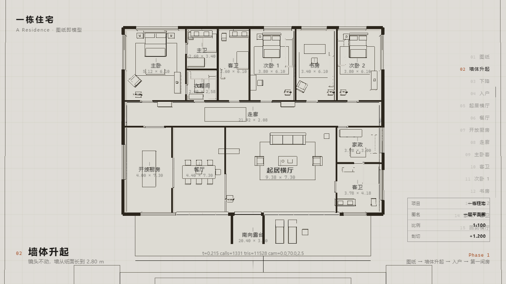
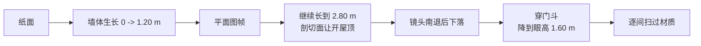

# 一栋住宅 · 图纸即模型

滚动驱动的住宅漫游。**户型图不是一张贴图，它本身就是那个 3D 模型**——墙体是真实几何体，俯视时压到 1.2 m 剖切高度，就是一张建筑平面图。滚动时墙体从纸面立起来，镜头下降到入户门前，再以人眼高度穿行全屋；每个房间在镜头抵达前保持线稿，抵达后真实材质扫过空间。

纯静态文件，无构建步骤，无 CDN 依赖。



## 跑起来

```bash
node serve.mjs          # http://127.0.0.1:8742/
```

ES modules 不能从 `file://` 加载，所以需要任意静态服务器（`python -m http.server` 也行）。

在线版本：<https://rzx007.github.io/scroll-house/>

## 它怎么工作

**图纸即模型。** 墙体是真实几何体，只在 Y 方向生长。剖切面从 0 升到 4.0 m；升到 1.20 m 的那一帧，画面恰好是一张标准平面图。俯视时每一面墙的切面会盖上深色填充，那就是平面图里的墙体涂黑。



**一台相机走完全程。** 一张 `PerspectiveCamera` 从 85 m 高空 fov 20° 的长焦俯视，一路插值到眼高 1.60 m 的 fov 55°，中间不切相机。图纸距离按视口宽高比反算——竖屏就让相机退得更远，而不是把长焦拉宽（拉宽既毁掉正交观感，又会撞上 fov 上限）。

**线稿与材质是同一套几何体。** 图纸上的黑线是真实几何体的 `EdgesGeometry`，不是画上去的。每间房一套材质，用噪声擦除从线稿过渡到 PBR，扫掠方向顺着镜头进入的方向，所以材质是在你前面展开而不是绕着你转。

**图纸态不是纯白平面，是去掉了贴图和投影的白色体块模型。** 纯线框在中段和室内读起来是"面条"，加上法线着光之后空间才立得住；而俯视时可见面全部朝上，图纸帧依然干净。

## 目录

```
index.html            入口，importmap 指向本地 vendor
styles.css            界面样式
serve.mjs             零依赖静态服务器
src/
  layout.js           建筑数据：房间、墙段、门窗洞口、材质扫掠时刻表
  timeline.js         剖切面 / 天光 / 逐房扫掠的关键帧
  main.js             渲染器、Lenis + ScrollTrigger 接线、质量档位
  camera/path.js      镜头关键帧
  build/
    shell.js          由 layout 生成墙、楼板、每间房的天花板
    plan.js           纸面、天光穹顶、房间标注
    site.js           场地：树线剪影、水池、总平面线稿
    furniture.js      参数化家具
    reveal.js         剖切面与切面封盖
  materials/library.js 材质库 + 扫掠着色器注入
  lib/                 PCHIP 插值、程序化贴图
vendor/               three.js 与附加模块（本地，不走 CDN）
assets/hdri/          Poly Haven CC0 环境贴图
tools/                验证与截图脚本
design/               方案提案与建成实录
```

## 工具

改任何东西之前值得先跑第一条。

```bash
powershell -File tools\check.ps1              # 语法 + 镜头路径 + 时间轴 + 调试残留
node tools/verify-path.mjs 1.78               # 镜头穿墙检测（改路径后必跑）
powershell -File tools\shot.ps1 -T "0.62;1"   # 无头截图，不碰你正在用的浏览器
powershell -File tools\fetch-assets.ps1       # 重新拉取 CC0 素材与 three 附加模块
```

`verify-path.mjs` 用真实插值器复现镜头路径，对 17 面墙和体块逐点做碰撞检测，要求每次穿墙都落在门洞内、且镜头在墙厚范围内不碰门垛。它抓到过 5 处真实穿墙——镜头斜穿门口擦到门垛。

开发时可以在 URL 上带参数：`?t=0.62` 把时间轴定死在某一点（用于审阅和截图），`?still=1` 只画 8 帧就停（让无头截图有确定结果），`?low=1` 强制走移动端质量档位。

## 素材与许可

- **环境贴图**：Poly Haven `safari_sunset`，CC0。选它是因为另外两个候选各有硬伤——`venice_sunset` 暖但在天际线上放了一座城市，`spaichingen_hill` 干净但地面是草坡，**它的绿色地面反弹会把室内每一块天花板染成橄榄色**。环境贴图的地面半球比天空半球更影响室内。
- **three.js** 与附加模块，MIT，本地 vendored。
- **GSAP / ScrollTrigger / Lenis** 各自许可，本地 vendored。
- 木材、石材、噪声贴图全部程序化生成，仓库里没有二进制贴图。

## 未完成

- 移动端质量档位（自动触发：关 bloom、影子贴图减半、DPR 降到 1.5）已实现，但没在真机上验证过观感
- 场地还可以继续做：目前只有树线剪影、水池和总平面线稿，没有真正的种植设计

方案提案与建成尺寸的出入记在 [`design/00-scheme-proposal.md`](design/00-scheme-proposal.md)，以其中的「建成实录」一节为准。
